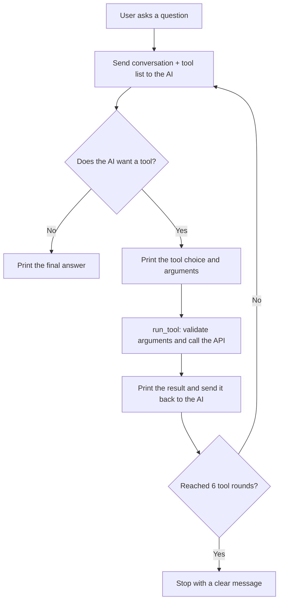

# Overview

As a software engineer, I wanted to learn how AI agents work: programs where an AI model does not just answer a question but decides which tools to use, calls them, reads the results, and decides what to do next. I focused on building an agent that is reliable, which means checking every input the AI sends, handling errors without crashing, limiting how long the agent can run, and making sure it only recommends real places instead of inventing them.

To practice these skills, I built **AI Travel Guide**, a Python command-line agent that answers travel questions. It uses the Claude API with direct tool calling (no agent framework), so I wrote the agent loop myself. The AI can choose between three tools:

| Tool | What it does | Data source |
|---|---|---|
| `find_location` | Turns a city name (like "Paris, France") into coordinates | Open-Meteo Geocoding API |
| `find_attractions` | Finds real, named places of one category (museum, gallery, park, historic, viewpoint, attraction) near a location | OpenStreetMap (Overpass API), with a small backup dataset |
| `get_weather` | Gets the daily forecast for up to 7 days | Open-Meteo Forecast API |

The AI decides which tools to use for each question. For example:

* "Where is Chicago?" → only `find_location`
* "What's the weather in Chicago this week?" → `find_location`, then `get_weather`
* "I'm going to Rome for 3 days. Indoor or outdoor activities?" → `find_location`, `get_weather`, and then `find_attractions` based on the forecast

Every decision is printed in the terminal, so the user can see which tool the agent chose, the arguments it sent, and the result:

```
You: What historic places are in Chicago?
[Agent chose tool] find_location({'place': 'Chicago, Illinois'})
[Tool result]      {"matches": [{"name": "Chicago", "region": "Illinois", ...}]}
[Agent chose tool] find_attractions({'latitude': 41.85, 'longitude': -87.65, 'category': 'historic'})
[Tool result]      {"source": "OpenStreetMap", "attractions": [], "message": "No historic attractions found within 5 km."}
[Agent chose tool] find_attractions({'latitude': 41.85, 'longitude': -87.65, 'category': 'historic', 'radius_km': 20})
[Tool result]      {"source": "OpenStreetMap", "attractions": [{"name": "Chicago Water Tower", ...}]}
Agent: ...
```

**How the agent works**



**Reliability features**

* **Input validation:** every tool checks its arguments (for example, latitude must be a number from -90 to 90, and the category must be one of six allowed values). Bad or missing arguments become an error message the AI can read and correct.
* **Error handling:** a missing or wrong API key, no internet connection, a busy AI service, or an unexpected response all show a clear message instead of crashing. A safety net in `run_tool` turns any unexpected tool problem into an error message, so one broken tool never stops the agent.
* **No invented attractions:** the system prompt only allows the AI to recommend places that `find_attractions` returned. If a search finds nothing, the agent may try once with a larger radius and otherwise says so honestly.
* **Iteration limit:** the agent can use at most 6 rounds of tool calls per question, so it can never get stuck in a loop.
* **Backup dataset:** OpenStreetMap's free servers are sometimes busy. The tool tries two servers, and if both fail it uses `attractions_fallback.json`, a small dataset of attractions in six cities, and tells the user the results came from backup data.
* **Conversation memory:** the agent remembers the conversation, so follow-up questions like "yes, please" or "what about museums?" work.

**How to run the program**

1. Create an API key in the [Claude Console](https://platform.claude.com/settings/keys).
2. Create a file named `.env` in the project folder with this line (this file is listed in `.gitignore` and is never committed):
   ```
   ANTHROPIC_API_KEY=your-key-here
   ```
3. Create a virtual environment and install the libraries:
   ```
   python3 -m venv .venv
   source .venv/bin/activate
   pip install -r requirements.txt
   ```
4. Start the agent and type `quit` to exit:
   ```
   python agent.py
   ```
5. (Optional) Test the tools without the AI:
   ```
   python travel_tools.py
   ```

My purpose for writing this software was to understand the difference between an AI-powered app, where the program always runs the same steps, and an AI agent, where the AI chooses its own steps. I also wanted to learn how to make an agent trustworthy, by controlling what it can do and handling the problems that come from depending on outside services.

[Software Demo Video](http://youtube.link.goes.here)

# Development Environment

* **Visual Studio Code** - code editor
* **Claude Console** - to create the API key and check usage
* **Git and GitHub** - version control

The program is written in **Python 3** and uses these libraries:

* **anthropic** - the official Anthropic Python SDK, used to send messages and tool definitions to the Claude model (`claude-haiku-5-5`) and read its tool choices
* **requests** - to call the Open-Meteo and OpenStreetMap web APIs
* **python-dotenv** - to load the API key from the `.env` file so it is never written in the code
* **json**, **math**, **pathlib**, **os**, and **sys** - from the Python standard library, used to build tool results, calculate distances (haversine formula), read the backup dataset, and check for the API key

# Useful Websites

- [Claude Docs - Tool use with Claude](https://docs.claude.com/en/docs/agents-and-tools/tool-use/overview)
- [Claude Docs - Models overview](https://docs.claude.com/en/docs/about-claude/models)
- [Open-Meteo Geocoding API](https://open-meteo.com/en/docs/geocoding-api)
- [Open-Meteo Weather Forecast API](https://open-meteo.com/en/docs)
- [OpenStreetMap Wiki - Overpass API](https://wiki.openstreetmap.org/wiki/Overpass_API)
- [Requests Documentation](https://requests.readthedocs.io/)
- [python-dotenv on PyPI](https://pypi.org/project/python-dotenv/)

# Future Work

- Add a backup for the weather tool, like the one for attractions, for when the weather service is down
- Add more categories, such as restaurants and beaches, and show opening hours when OpenStreetMap has them
- Add a tool that builds a day-by-day itinerary from the attractions and the forecast
- Save recent search results so repeated questions are faster and use fewer API calls
- Build a simple web page instead of the command-line interface

# AI Assistance

I used Claude (Anthropic's AI assistant) while building this project to help explain how tool calling works, review my code, and suggest ways to add input validation and error handling. I tested every feature myself and made the design decisions for the agent.